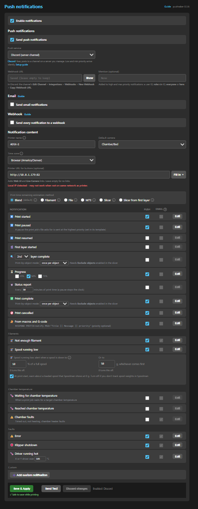
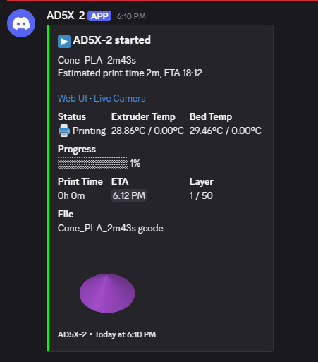
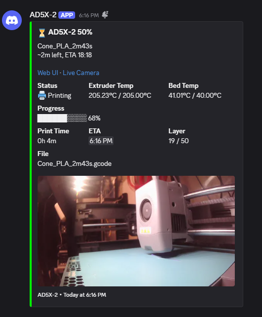
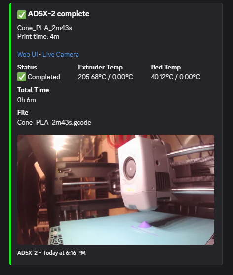

# zmod_pushraker

> **Archived 2026-11-18.** This plugin is now part of [diehard-pushraker](https://github.com/DIEHARDave/diehard-pushraker), one plugin for Kiln OS, Zmod and the FLSUN T1 (same features, plus the update notices). Your notification settings carry over: see its README, *Moving from the old plugins*.

[pushraker](https://github.com/noon92/pushraker) push notifications for
**Zmod** (FlashForge AD5X, Adventurer 5M, Creator 5), as a Zmod plugin.

pushraker sends a notification when a print starts, pauses, resumes,
completes or is cancelled, at progress steps and the first layer, and on
faults and shutdowns. Notifications can carry a camera snapshot, the model
preview or a spool picture, and can go to ntfy, Pushover, Gotify, Telegram,
Discord, a webhook or e-mail (through [Apprise](https://github.com/caronc/apprise)).
You set it all up on its own web page, and changes apply at once with no
restart. The [pushraker guide](https://github.com/noon92/pushraker/blob/main/docs/guide.md)
covers the settings.

It replaces Zmod's `notify` plugin (and `notify_discord`, its Discord
add-on): turn those off first, both would send for the same events.

<p align="center">
  
</p>

## Discord cards

A Discord message gets the status card fields that
[notify_discord](https://github.com/DIEHARDave/notify_discord) added to
Zmod's notifications, under pushraker's title and text:

- Status, Extruder Temp and Bed Temp, side by side.
- During a print: a progress bar, then Print Time, ETA (shown in each
  reader's own time zone) and Layer, then File.
- When a print ends: ✅ Completed or 🚫 Cancelled, with Total Time and File.
- The printer's name and the time it was sent, in the footer.

The color follows the printer: green while printing or complete, orange
when paused, blue when ready. pushraker's error and failure notifications
stay red. The camera snapshot stays inside the card, below the fields.
To turn the cards off, set `discord_cards: False` under `[pushraker_cards]`
in `zmod_pushraker.moonraker.conf` and reboot.

<p align="center">
  
  
  
</p>

## Install

1. In the console (Fluidd, Mainsail):

   ```
   DISABLE_PLUGIN name=notify_discord
   DISABLE_PLUGIN name=notify
   ```

   (whichever of them you have on; each reboots the printer)

2. Add this to `mod_data/user.moonraker.conf`:

   ```ini
   [update_manager zmod_pushraker]
   type: git_repo
   channel: stable
   path: /root/printer_data/config/mod_data/plugins/zmod_pushraker
   origin: https://github.com/DIEHARDave/zmod_pushraker.git
   is_system_service: False
   primary_branch: main
   ```

3. In the console:

   ```
   ENABLE_PLUGIN name=zmod_pushraker
   ```

   The printer reboots.

4. Open **http://&lt;printer&gt;:82/notifications/**, add where the
   notifications should go, choose which events you want, and Save & Apply.
   Notifications are off until you do.

## What it changes

- **Moonraker** (in Zmod's chroot): links `moonraker/pushraker.py` and
  `moonraker/pushraker_cards.py` into Moonraker's `components` and
  includes `zmod_pushraker.moonraker.conf` from
  `mod_data/plugins.moonraker.conf`. The pushraker package is in
  `python/`; Apprise, requests, Pillow and Jinja2 come from Zmod's
  Moonraker environment. Settings: `printer_data/config/pushraker.conf`;
  tokens and passwords: `printer_data/pushraker.secrets` (outside the
  config folder, never served).
- **Klipper:** pushraker's macros, and the print-end and cancel snapshots
  taken before the toolhead parks:
  - Zmod's `END_PRINT` starts with `_NOTIFY TYPE=end`, an empty hook that
    Zmod's notify plugin fills. This plugin fills it with pushraker's
    print-end hook instead (so it can't run next to notify).
  - Zmod's `CANCEL_PRINT` has no such hook: `[pushraker_hooks]`
    (`klipper/pushraker_hooks.py`, linked into Klipper's extras) runs
    pushraker's cancel hook at its start, once per cancel (Zmod passes a
    cancel to the native screen, which sends it back).
- **Settings page:** a second nginx on port 82, built from Zmod's own
  nginx template (as [zmod_dualweb](https://github.com/DIEHARDave/zmod_dualweb)
  does for port 81), started at every Klipper start. `PUSHRAKER_WEB`
  shows whether it runs, `PUSHRAKER_WEB STOP=1` stops it.

`DISABLE_PLUGIN name=zmod_pushraker` takes it all out again; the
notification settings stay.

## Updates

Fluidd or Mainsail, Software Updates: **zmod_pushraker**. Reboot after an
update so Moonraker loads a new pushraker.

## For maintainers

- `python tools/vendor.py [version]` refills `python/` with pushraker from
  PyPI, then applies the fixes in `PATCHES` (a settings page fix for
  printers without the U1's filament change row, sent upstream).
- New pushraker releases are picked up by a daily check
  (`.github/workflows/pushraker-release.yml`). It opens a pull request
  that re-vendors `python/` and reports the page fix and test results.
  Try it on a printer before merging (the PR says how), then tag.
- `python test_zmod_pushraker.py` (needs `pip install apprise requests
  jinja2 pillow`): offline checks of the macros, the hooks module, the
  Discord cards and the scripts.
- The Klipper hooks module and the Discord cards are the same files as in
  [pushraker-kiln](https://github.com/DIEHARDave/pushraker-kiln).

## License

GPL-3.0-or-later, like pushraker. pushraker is by
[@noon92](https://github.com/noon92); its license is in
`python/pushraker-*.dist-info`.
